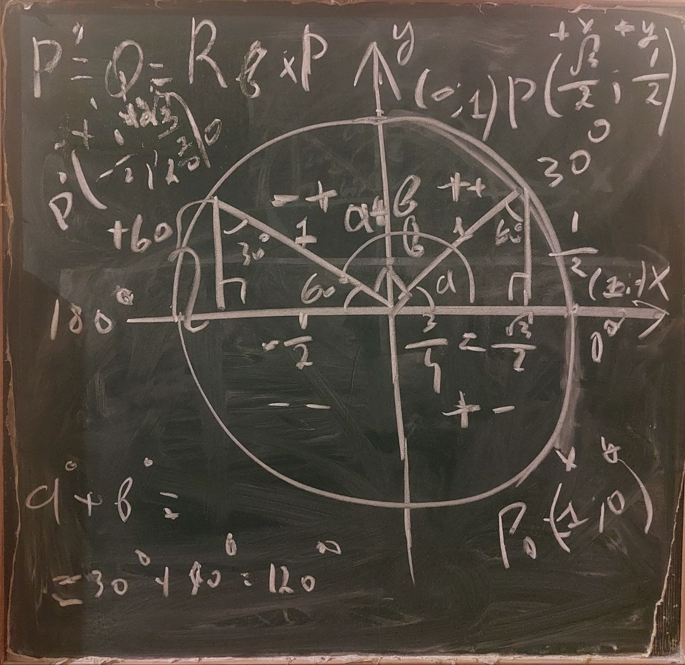

```
In this article, theta θ is used instead of x as the mathematical symbol: 
x = θ

In general, why is sin(2θ) needed? What is it actually used for?

It is an expression that arises naturally in certain problems. 
The "double-angle formula" helps to calculate it in a different form or to simplify it.

Let's say, θ = 30° and you want to find the sine of 60°:
60° = 2 * (30°)
sin(60°) = sin(2 * 30°)
sin(2θ) = 2sinθ cosθ
sin(60°) = 2sin30° cos30°

In other words, you can use it to find the sine of double an angle.
Or, tan(θ) is given: tan(θ) = 3/4, but sin(2θ) = ? is asked.
With the usual way, first sin(θ) and cos(θ) can be found. 
But if you know this form of the "double-angle formula":
sin(2θ) = 2tan(θ) / (1 + tan²(θ))
sin(2θ) = 2(3/4) / (1 + (3/4)²) = 24/25

It is also a convenient formula for simplification operations in trigonometric equations or integrals, 
for example, when you encounter 2sinθ cosθ, you can easily replace it with sin(2θ).


The main purpose of this article is to determine the origin of the 
"Double-Angle Identity" formula for sine:
sin 2θ = 2 sinθ cosθ = 2 tgθ / (1 + tg²θ)   ->   ???

First of all, where does the "sin(2θ) = 2 sinθ cosθ -> sin(60°) = 2 sin30° cos30°" come from?
To find the answer to this (above) question, in the first place, it's necessary to clarify 
where and how the "sine addition formula" is derived:

sin(a + b) = sin a cos b + cos a sin b ?
```

```
To better demonstrate the underlying principle, we choose a = 30° and b = 90°, 
as this is very convenient. 
The sequence is presented both: in written form and graphically.

P' = Q = Rᵦ * P
Rᵦ - rotation matrix

1)
     x  y
{ P₀(1, 0)
{ P₀(cos 0, sin 0)


2)
a = 30°

    +x    +y   <--   due to 1st quarter both signs are positive: ++
{ P(cos a, sin a) 
{ P(cos 30°, sin 30°)
{ P(√3/2, 1/2)  


3)
b = 90°
a + b = 30° + 90° = 120°

          -x'         +y'   <--   due to 2nd quarter signs are: -+
P' = Q = (cos(a + b), sin(a + b))
P' = Q = (cos(a + 90°), sin(a + 90°))
P' = Q = (cos(30° + 90°), sin(30° + 90°))
P' = Q = (cos 120°, sin 120°)
P' = Q = (-1/2, √3/2)


We notice that:
x = √3/2; y = 1/2

{ x' = -y = -1/2
{ y' = x = √3/2

 x      y         x'          y'             -y      x
(cos a, sin a) -> cos(a + b), sin(a + b) => (-sin a, cos a)
(x, y)         -> (x', y')               => (-y, x)
(√3/2, 1/2)    -> (-1/2, √3/2)           => (-1/2, √3/2)

  x'           x'             -y
{ cos(a + b) = cos(a + 90°) = -sin a   ->   x' = -y = -sin (cos => -sin)
  y'           y'             x
{ sin(a + b) = sin(a + 90°) = cos a    ->   y' = x = cos (sin => cos)

cos 120° = -1/2 = -sin 30°
sin 120° = √3/2 = cos 30°


Since we can write the point P(x, y) as x(1; 0) + y(0; 1):
P(3; 2):
3 steps to the right: x-direction
2 steps up: y-direction

╭─ (0; 0) -> (3; 0) -> (3; 2) = P(3; 2)
│
└→ 3(1; 0) + 2(0; 1) = (3; 0) + (0; 2) = (3; 2)

   (1; 0) - beginning
{ x(1; 0) = (x; 0)
{ 3(1; 0) = (3; 0)

{ y(0; 1) = (0; y)
{ 2(0; 1) = (0; 2)


P = x(1; 0) + y(0; 1) = 
  = (x; 0) + (0; y) = 
  = (x + 0; 0 + y) = (x; y)
      
       0°              90°
P = x( 1 ) -> cos +  y( 0 ) -> cos
     ( 0 ) -> sin     ( 1 ) -> sin
     
  0°
(1; 0) - initial 0° + b = ( cos b ) => x( cos b ) 
                          ( sin b )     ( sin b )
(after rotating by b)

  90°
(0; 1) - subsequent 90° + b = ( cos(90° + b) ) = y( -sin b ) 
(after rotating by b)         ( sin(90° + b) )    (  cos b ) 

( cos(0° + b) ) 
( sin(90° + b) )
↓
P' = x( cos b ) + y( -sin b ) =
      ( sin b )    (  cos b )

   = ( x cos b ) + ( y -sin b ) =
     ( x sin b )   ( y cos b )

   = ( x cos b - y sin b )   ->   x'
     ( x sin b + y cos b )   ->   y'


That is why:
1)
{ x' = x cos b - y sin b
{ y' = x sin b + y cos b

2)
{ x = cos a
{ y = sin a

3)
{ x' = cos a cos b - sin a sin b
{ y' = cos a sin b + sin a cos b


What does the result show?
P' = ( x' ) = ( cos b  -sin b ) * ( x ) =
     ( y' )   ( sin b   cos b )   ( y )

   = ( cos b -sin b ) * ( cos a ) =
     ( sin b  cos b )   ( sin a )

   = ( cos a cos b - sin a sin b )
     ( cos a sin b + sin a cos b )

P' = Rᵦ * P:
P' -> P' -> ( cos(a + b) )
            ( sin(a + b) )

Rᵦ -> ( cos b  -sin b )
      ( sin b   cos b )

P  -> ( x )
      ( y )


Let's come to the main point - we said:
a = x, b = x
y' = sin(a + b) = cos a sin b + sin a cos b
y' = sin(x + x) = cos x sin x + sin x cos x
y' = sin(2x) = 2 sin x cos x


Additionally, to bypass multiple stages and to reach the result more quickly, 
we proceed an alternative verification method  as follows:
       0°              90°
P = x( 1 ) -> cos +  y( 0 ) -> cos
     ( 0 ) -> sin     ( 1 ) -> sin
     
  0°
(1; 0) - initial 0° + a = ( cos a ) => x( cos a ) 
                          ( sin a )     ( sin a )
(after rotating by b)

  90°
(0; 1) - subsequent 90° + a = ( cos(90° + a) ) = y( -sin a ) 
(after rotating by b)         ( sin(90° + a) )    (  cos a )     

P' = x( cos a ) + y( -sin a ) =
      ( sin a )    (  cos a )

   = ( x cos a ) + ( -y sin a ) =
     ( x sin a ) + (  y cos a )

   = ( x cos a - y sin a ) =   ->   x = cos a
     ( x sin a + y cos a )     ->   y = sin a

   = ( cos a cos a - sin a sin a ) -> x'
     ( cos a sin a + sin a cos a ) -> y'

y' = sin(a + a) = cos a sin a + sin a cos a


Thus, there is no need for additional steps such as the assignments:
a = x and b = x.

Scheme:
Rotation matrix -> Sine addition formula -> Double-angle identities
   

We return to the part of the article's introduction where we posed the main question:
sin 2θ = 2 sinθ cosθ = 2 tgθ / (1 + tg²θ)   ->   ???

sin²θ + cos²θ = 1
(sin²θ / cos²θ) + (cos²θ / cos²θ) = 1 / cos²θ

sinθ / cosθ = tgθ
sin²θ / cos²θ = tg²θ

cos²θ / cos²θ = 1

1 / cosθ = secθ
1 / cos²θ = sec²θ

tg²θ + 1 = sec²θ = 1 / cos²θ
tg²θ + 1 = 1 / cos²θ
cos²θ = 1 / (tg²θ + 1)


sin 2θ = (2 sinθ cosθ)

tgθ = sinθ / cosθ
tgθ * cosθ = (sinθ / cos θ) * cosθ
tgθ * cosθ = sinθ
sinθ = tgθ * cosθ

2 sinθ cosθ = 2 * (tgθ * cosθ) * cosθ =
            = 2 * tgθ * cos²θ
                   or
              2 * tgθ * (cosθ)²

Note: cos²θ = 1 / (1 + tg² θ)

2 tgθ cos²θ = 2 tgθ * 1 / (1 + tg²θ) =
            = 2 tgθ / (1 + tg²θ)


Final result: sin 2θ = 2 sinθ cosθ = 2 tgθ / (1 + tg²θ)

```